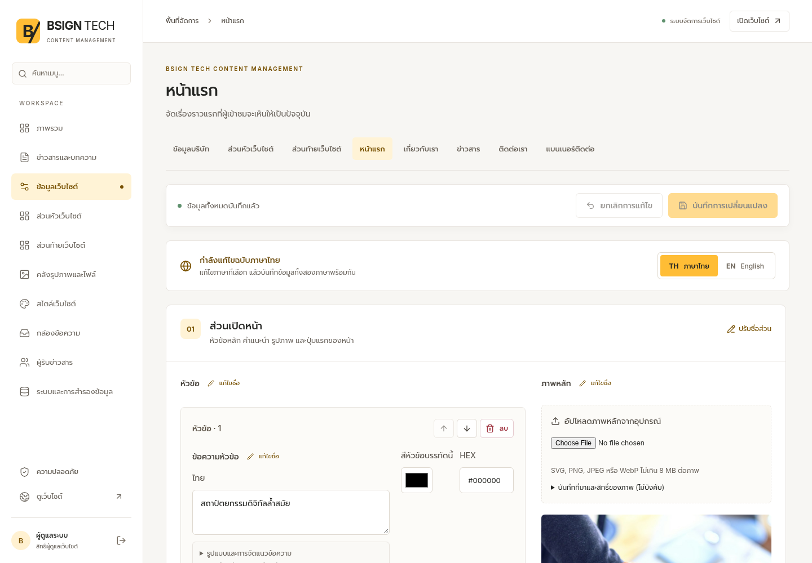

# BSIGN TECH — v1.8.1

เว็บไซต์ TH/EN ตามภาพส่งออก Figma ที่ผู้ใช้แนบ: หน้าแรก เกี่ยวกับเรา ข่าวสาร รายละเอียดข่าว และติดต่อเรา พร้อม CMS, REST API และ SQLite จริง

v1.8.1 ปรับตัวเปิด Windows ให้แตกไฟล์ Node.js ได้เร็วขึ้น และใช้แคชไฟล์ดาวน์โหลดข้ามโฟลเดอร์เวอร์ชัน ดูรายละเอียดใน [docs/STARTUP-PERFORMANCE.md](docs/STARTUP-PERFORMANCE.md) และผลทดสอบใน [docs/VALIDATION.md](docs/VALIDATION.md) งานหน้าเว็บจาก v1.8.0 อยู่ใน [docs/REVISION-05.md](docs/REVISION-05.md)

v1.6.3 เพิ่มเงาภาพหลักและภาพส่วนทำไมต้องเลือกเราในหน้าแรก โดยใช้เงาเดียวกับการ์ดภาพหน้าเกี่ยวกับเรา

v1.7.0 เอากรอบหัวข้อหน้า “ติดต่อเรา” ออก จัดหัวข้อทั้งสามส่วนไว้กึ่งกลางตามภาพดีไซน์ และปรับหัวข้อช่องทางติดต่อ/แบบฟอร์มด้วยสไตล์กลาง **หัวข้อการ์ดเนื้อหา** ขนาด Desktop/Tablet/Mobile 24/22/20px ปรับต่อได้ในหลังบ้านที่ **สไตล์เว็บไซต์ → ตัวอักษร** การอัปเดตเติมเฉพาะสไตล์ที่ขาด โดยรักษาข้อมูลและค่าที่แก้ไว้เดิม

## เปิดครั้งแรกให้เร็วขึ้นใน v1.8.1

- ใช้ตัวแตก ZIP ของ .NET แทน `Expand-Archive` ของ Windows PowerShell 5.1 พร้อมให้หน้าต่างยังรับคำสั่งยกเลิกระหว่างทำงานได้
- ไฟล์ ZIP ของ Node.js และแพ็กเกจ npm ที่ดาวน์โหลดแล้วเก็บใน `%LOCALAPPDATA%\BSIGN TECH\preview-cache` เพื่อใช้ซ้ำเมื่อแตกเวอร์ชันใหม่ ระบบตรวจ SHA-256 ของ ZIP ให้ตรงกับรุ่น/สถาปัตยกรรมก่อนใช้
- `node_modules` และ Node.js ที่รันจริงยังแยกตามโปรเจกต์ การติดตั้งแพ็กเกจยังตรวจตาม lockfile ด้วย `npm ci`; ถ้าแคชส่วนกลางใช้ไม่ได้ จะใช้พื้นที่ใน `.runtime` ตามเดิม
- ครั้งแรกของเครื่องยังต้องดาวน์โหลดไฟล์ที่ไม่มีในแคช ระยะเวลาจริงขึ้นกับอินเทอร์เน็ต ดิสก์และเครื่อง การเปิดซ้ำในโฟลเดอร์เดิมให้เก็บ `.runtime`, `node_modules` และ `dist` ไว้ เพื่อใช้ dependency/build stamps เดิม
- ข้อมูลเนื้อหา รูป ฟอนต์ และบัญชียังอยู่ใน `.data` (หรือ `DATA_DIR` เดิม) ไม่ได้เก็บในแคชเครื่องมือ และไม่ต้องตั้งค่าขั้นตอนเพิ่มเติม

## เปิดพรีวิวบน Windows — ดับเบิลคลิก START-WINDOWS

1. ดาวน์โหลด ZIP ของเวอร์ชันที่ต้องการ แล้ว **แตกไฟล์ทั้งโฟลเดอร์**
2. เปิดโฟลเดอร์ที่แตกออกมา แล้วดับเบิลคลิก **START-WINDOWS.cmd** (Explorer ที่ซ่อนนามสกุลจะแสดงชื่อ **START-WINDOWS**)
3. หน้าต่าง **CMD** จะเตรียมเครื่องมือ ติดตั้งส่วนประกอบ และ build เว็บไซต์อัตโนมัติ รอจนขึ้น **Website ready** แล้วเว็บไซต์จะเปิดในเบราว์เซอร์เอง
4. เมื่อต้องการเข้าหลังบ้าน ให้เพิ่ม **/admin** ต่อท้าย URL เดิม เช่น `http://127.0.0.1:พอร์ต/admin` ใช้พอร์ตที่เปิดจริงหรือคัดลอก **Admin panel** จาก CMD
5. เปิดไฟล์ **.data/initial-admin.txt** ในโฟลเดอร์โปรเจกต์ แล้วคัดลอก **Username** และ **Password** ไปเข้าสู่ระบบ
6. เปิดหน้าต่าง CMD นี้ค้างไว้ขณะพรีวิว เมื่อเสร็จให้กด **Ctrl+C** ในหน้าต่างนั้นเพื่อหยุด ข้อมูลยังอยู่เมื่อเปิดใหม่

ไม่ต้องพิมพ์คำสั่งเอง ไม่ต้องติดตั้ง Node.js เอง และไม่ต้องมีสิทธิ์ Administrator ตัวเปิดใช้ Node.js 24 แบบ portable ใน `.runtime` ของโปรเจกต์ ตรวจ SHA-256 จากรายการที่ตรึงไว้ของ nodejs.org ก่อนใช้ และไม่แก้ Node.js หรือ PATH ถาวรของเครื่อง ครั้งแรกต้องใช้อินเทอร์เน็ตเพื่อดาวน์โหลดเครื่องมือและส่วนประกอบ ครั้งถัดไปใช้ cache หากโค้ดและ dependencies ไม่เปลี่ยน

CMD แสดง URL เว็บไซต์, URL แอดมิน และตำแหน่งไฟล์บัญชี โดยไม่พิมพ์รหัสผ่านออกหน้าจอ หากดับเบิลคลิกตัวเปิดซ้ำจากโฟลเดอร์เดิม จะเปิดเว็บไซต์ที่กำลังรันอยู่ พรีวิวเลือกพอร์ตว่างอัตโนมัติและรับเฉพาะเครื่องนี้ ปิดเบราว์เซอร์อย่างเดียวจะยังไม่หยุดเซิร์ฟเวอร์

รองรับ Windows 10/11 แบบ x64 และมีตัวเลือกดาวน์โหลด ARM64 ตามสถาปัตยกรรมเครื่อง ผลทดสอบจริงและขอบเขตอยู่ใน `docs/VALIDATION.md`

START-WINDOWS รุ่นนี้ตรวจ SHA-256 ของสคริปต์ตัวเปิดทั้ง 4 ไฟล์ แล้วปลด Mark-of-the-Web เฉพาะไฟล์ที่ตรงกับรุ่น ก่อนเรียก PowerShell จึงเปิด ZIP ที่ดาวน์โหลดมาได้โดยไม่ต้องปลดบล็อก .ps1 เอง ไม่ปลดบล็อกไฟล์อื่นในโฟลเดอร์ และไม่เปลี่ยน Execution Policy ถาวรของเครื่อง การตรวจ hash เป็นการตรวจความครบชุดของไฟล์ ไม่ใช่ลายเซ็นยืนยันผู้เผยแพร่ หากเครื่ององค์กรบังคับให้สคริปต์ต้องมีลายเซ็นหรือห้าม PowerShell ต้องให้ฝ่ายไอทีอนุญาตก่อน หากเตรียมระบบไม่สำเร็จ อ่านข้อความใน CMD และเปิดไฟล์ `.runtime/logs/setup.log` ด้วย Notepad แล้วลองเปิด START-WINDOWS ใหม่ มีคู่มือแบบเปิดอ่านได้ที่ `START-HERE.html`

### Username และ Password ใน initial-admin

**ระบบสร้างบัญชีและรหัสผ่านสุ่มบนเครื่องคุณเมื่อรัน START-WINDOWS ครั้งแรกและฐานข้อมูลยังไม่มีผู้ดูแล** ZIP ที่ดาวน์โหลดไม่มีรหัสผ่านฝังมา และรหัสผ่านแต่ละเครื่องไม่เหมือนกัน

- เปิด **.data/initial-admin.txt** ด้วย Notepad; หาก Explorer ซ่อน `.txt` จะเห็นชื่อไฟล์ **initial-admin**
- ค่า **Username** เป็นอีเมล ให้นำไปกรอกช่องอีเมลในหน้า `/admin` และใช้ค่า **Password** จากไฟล์เดียวกัน
- ถ้ากำหนด `DATA_DIR` ใน `.env` ไฟล์จะอยู่ในโฟลเดอร์ข้อมูลที่กำหนด ให้ดูตำแหน่งจริงใน CMD
- การเปิดซ้ำและการอัปเดตที่เก็บข้อมูลเดิมไว้จะใช้บัญชีเดิม และไม่เขียนไฟล์บัญชีทับ
- หลังเปลี่ยนรหัสผ่านในหลังบ้านหรือผ่านหน้ากู้บัญชี ให้ใช้รหัสผ่านใหม่ที่คุณตั้ง ค่าในไฟล์ initial-admin เป็นรหัสเริ่มต้นและจะไม่เปลี่ยนตาม

ถ้าอัปเดตจาก v1.1.0 แล้วมีบัญชีที่ตั้งเองอยู่ ระบบจะรักษาบัญชีและรหัสผ่านเดิมไว้ จึงอาจไม่มีไฟล์ initial-admin ให้เข้าสู่ระบบด้วยอีเมล/รหัสผ่านเดิม หากจำไม่ได้ ให้หยุดตัวเปิดแบบ CMD ก่อน แล้วเปิด **OPEN-PREVIEW.vbs** และกด **บัญชีแอดมิน / ลืมรหัสผ่าน** เพื่อเลือกอีเมลและตั้งรหัสผ่านใหม่ เนื้อหาและรูปภาพยังอยู่

`OPEN-PREVIEW.vbs` เป็นตัวเลือกเปิดแบบหน้าต่างจากเวอร์ชันก่อน มีปุ่มเปิดเว็บ/หลังบ้าน/กู้บัญชีและหยุดพรีวิว การกู้บัญชีใช้ลิงก์เฉพาะที่ตัวเปิดบนเครื่องนี้สร้างให้ ไม่เปิดความสามารถนี้ใน `npm start` หรือ Docker บนเซิร์ฟเวอร์สาธารณะ ไฟล์ initial-admin มีข้อมูลเข้าสู่ระบบ ให้เก็บไว้กับผู้ดูแลที่มีสิทธิ์เข้าถึงโปรเจกต์

### อัปเดตจาก ZIP เวอร์ชันเก่าโดยไม่พิมพ์คำสั่ง

1. หยุดพรีวิวเก่า: แบบ CMD กด **Ctrl+C**; แบบหน้าต่างกด **หยุดพรีวิวและปิด**
2. เก็บสำเนาโฟลเดอร์เก่าทั้งโฟลเดอร์ไว้เป็น backup แล้วแตก ZIP ใหม่ในอีกโฟลเดอร์
3. คัดลอก **.data** และ **.env** จากเวอร์ชันเก่าไปยังโฟลเดอร์ใหม่ **ก่อนเปิดครั้งแรก** รวมไฟล์ initial-admin ถ้ามี หากตั้ง `DATA_DIR` เอง ให้รักษาโฟลเดอร์ข้อมูลตามค่าที่ใช้ด้วย
4. เปิด **START-WINDOWS.cmd** จากโฟลเดอร์ใหม่ บัญชี เนื้อหา และรูปเดิมยังอยู่ ไม่ต้องคัดลอก node_modules หรือ .runtime

ห้ามเปิดพรีวิวสองเวอร์ชันพร้อมกันโดยใช้ฐานข้อมูลเดียวกัน

## สำหรับนักพัฒนา / เซิร์ฟเวอร์

ติดตั้ง Node.js 24 LTS แล้วรันในโฟลเดอร์โปรเจกต์:

```sh
npm ci
cp .env.example .env
npm run build
npm run admin:create
npm start
```

โหมดเซิร์ฟเวอร์ใช้ `http://localhost:3000` และ CMS ที่ `/admin` โดย origin ต้องตรง `APP_ORIGIN` ส่วนตัวเปิดพรีวิวจัดการ origin/port ให้เองโดยไม่แก้ `.env`

`npm run dev` ใช้ Vite hot reload และ API ใน origin เดียวกัน แม้มี dist อยู่แล้ว ส่วน `npm start` เสิร์ฟ production build โหมด dev อนุญาต Vite inline preamble/WebSocket ใน CSP เฉพาะระหว่างพัฒนา โหมด production ใช้ CSP ที่เข้มงวดกว่า

## สีข้อความและการแสดงผลที่เพิ่มใน v1.8.0

- เปิดหน้าจัดการเนื้อหาที่ต้องการ เช่น **ส่วนหัวเว็บไซต์**, **ติดต่อเรา** หรือ **ข่าวสารและบทความ** แล้วเปิด **รูปแบบ สี และการจัดแนวข้อความ** ใต้ช่องนั้นเพื่อเลือกสีเฉพาะข้อความ ไม่ต้องแก้สไตล์ส่วนกลาง
- เลือกสีด้วย Color Picker หรือรหัส HEX 6 หลัก ดูตัวอย่าง แล้วกดบันทึก สีของช่องใช้ร่วมกันทั้ง TH/EN; เมื่อต้องการกลับไปใช้สีเดิมให้คืนค่าตามสไตล์แล้วบันทึก
- ชื่อแบรนด์ใช้ข้อมูลร่วมกันระหว่างส่วนหัวและส่วนท้าย จึงเปลี่ยนสีตามช่องชื่อแบรนด์เดียวกัน หัวข้อรายบรรทัดเดิมยังใช้สีประจำบรรทัดเมื่อไม่มีสีเฉพาะข้อความ
- เมนู Header/Footer และหมวดข่าวที่เลือกแสดงตัวหนา 700 รายการอื่น 400 ปกข่าวเด่นย่อเฉพาะที่แสดงสูงสุด 3 บรรทัดต่อหัวข้อ/คำโปรย โดยหน้ารายละเอียดข่าวยังใช้ข้อมูลเต็ม
- ไม่เพิ่ม migration และไม่เขียนข้อมูลเก่าทับ เก็บ `.data` ทั้งโฟลเดอร์และ `.env` เดิมตามวิธีอัปเดตด้านบน

## ฟอนต์และงานหลังบ้านที่เพิ่มใน v1.7.0

- **สไตล์เว็บไซต์ → คลังฟอนต์** มีฟอนต์ไทย 20 แบบตามรายการ พร้อมฟอนต์เดิม เลือกตัวอย่าง ดูน้ำหนัก/รูปแบบที่มีจริงและใบอนุญาต ฟอนต์มาตรฐานเก็บมากับแอป ไม่โหลด Google Fonts ขณะเปิดเว็บไซต์
- อัปโหลด WOFF2, WOFF, TTF หรือ OTF ได้ครั้งละไฟล์ ไม่เกิน 5 MB ระบุชื่อและที่มา/สิทธิ์การใช้งานได้ ระบบตรวจรูปแบบ ข้อมูลที่คลายแล้วไม่เกิน 32 MB และสร้างชื่อไฟล์/ชื่อ family ภายในให้เอง จากนั้นเลือกฟอนต์ใน **ตัวอักษร** แล้วบันทึกสไตล์
- การเลือกฟอนต์ใช้ร่วมกันทั้ง TH/EN และตามชนิดข้อความ ฟอนต์บางแบบ เช่น Itim และ Chonburi มีน้ำหนัก 400 เท่านั้น หากเลือกน้ำหนักอื่น เบราว์เซอร์อาจจำลองน้ำหนักให้ รายการน้ำหนักจริงแสดงในคลัง
- ลบฟอนต์ที่มีข้อมูลอ้างอิงอยู่ไม่ได้ ต้องเปลี่ยนส่วนที่ใช้งานและบันทึกก่อน ฟอนต์ที่อัปโหลดอยู่ใน `DATA_DIR/fonts` สำรอง/กู้คืนพร้อมฐานข้อมูลและรูป เก็บโฟลเดอร์ `.data` ทั้งชุดเมื่อต้องการอัปเดต
- **หน้าเข้าสู่ระบบ** จัดการข้อความ แบรนด์ ป้ายช่องกรอก ปุ่ม คำแนะนำ และสถานะ Login พร้อมตัวอย่างก่อนบันทึก ใช้ `{brand}`, `{company}`, `{companyEn}`, `{year}` แทนข้อมูลบริษัท/ปีได้ การตั้งค่าหน้านี้ไม่เปลี่ยนบัญชีหรือรหัสผ่าน
- แถบเมนูหลังบ้านและ Login ใช้โลโก้/แบรนด์จริงจากข้อมูลบริษัทและส่วนหัวเว็บไซต์ การ์ดจุดเด่นหน้าแรกมีตัวเลือกสีพื้นและกรอบอยู่ในแต่ละการ์ด
- หน้าติดต่อหลังบ้านแบ่งส่วนและรายการชัดเจน ไอคอนอยู่ในรายการอีเมล โทรศัพท์ เวลา ช่องทางโซเชียล ปุ่มส่ง และสำนักงาน เปลี่ยนแพลตฟอร์ม เพิ่ม/ลบ/เรียงลำดับโซเชียลได้โดยไอคอนประจำรายการย้ายตาม ไม่สร้างลิงก์บัญชีที่ยังไม่ได้ระบุ

แหล่งฟอนต์และใบอนุญาต: [FONT-LICENSES.md](docs/FONT-LICENSES.md) · แหล่งโลโก้โซเชียล: [SOCIAL-ASSETS.md](docs/SOCIAL-ASSETS.md) ไอคอนใน Google Maps และ UI ของเบราว์เซอร์ยังควบคุมโดยบริการ/โปรแกรมนั้น

## การใช้งาน CMS

v1.6.2 รวมตัวสลับภาษา **TH/EN** กับ **ตั้งค่าการเผยแพร่** ไว้ในการ์ดเดียวกันฝั่งขวาของหน้าแก้ไขบทความ การ์ดค้างอยู่ขณะเลื่อนถึงเนื้อหา แกลเลอรี หรือท้ายหน้า บน Tablet/Mobile การ์ดจะอยู่เหนือเนื้อหาและพับส่วนตั้งค่าได้ โดยปุ่มภาษายังแสดงอยู่ หากตั้งค่ายาวกว่าจอ สามารถเลื่อนภายในการ์ดถึงปุ่มบันทึกได้ ข้อความที่ยังไม่ได้บันทึกของทั้งสองภาษายังคงอยู่เมื่อสลับภาษา

v1.6.1 แก้หน้าแรกให้แสดง **3 บทความที่เผยแพร่ล่าสุดจากทุกหมวดหมู่** แยกจากจำนวนข่าวต่อหน้าที่ตั้งไว้ในหน้าข่าว บทความฉบับร่างหรือที่ตั้งวันเผยแพร่ในอนาคตยังไม่แสดงต่อผู้เข้าชม หากมีบทความที่เผยแพร่ถึงเวลาน้อยกว่า 3 รายการ จะแสดงเท่าที่มี

ช่องลิงก์บทความเว้นว่างได้ ระบบสร้าง URL ที่ไม่ซ้ำให้ตอนบันทึกบทความใหม่ บทความเดิมที่เว้นช่องนี้ว่างจะใช้ลิงก์เดิม แกลเลอรีใช้ภาพย่อแบบ 3 คอลัมน์บน Desktop, 2 บน Tablet และ 1 บน Mobile พร้อมเมนูแก้คำอธิบาย/เปลี่ยนภาพในแต่ละภาพ รายการแก้ไขอยู่ใน [REVISION-03.md](docs/REVISION-03.md)


ระบบหลังบ้านใช้เมนูพื้นขาว พื้นที่ทำงานสีขาวนวล และฟอนต์ Prompt / Inter ที่จัดเก็บมากับแอป พร้อมสีแบรนด์ BSIGN TECH หลังเข้าสู่ `/admin` จะเปิดหน้า **ภาพรวม** พร้อมข้อมูลจริงจากฐานข้อมูล ค้นหาเมนูได้ บนมือถือใช้ปุ่ม **เปิดเมนูจัดการ** และปิดด้วย Escape

- **ข้อมูลเว็บไซต์** มีหน้าจัดการส่วนหัวเว็บไซต์ ส่วนท้ายเว็บไซต์ ข้อมูลบริษัท หน้าแรก เกี่ยวกับเรา ข่าวสาร ติดต่อเรา และแบนเนอร์ติดต่อ หน้าแรก/เกี่ยวกับเรา/ข่าวสารจัดเป็นกลุ่มที่มีหมายเลขเรียงต่อกัน ชื่อกลุ่ม รายการ และตัวควบคุมอยู่ใกล้เนื้อหาที่เกี่ยวข้อง
- ชื่อส่วน คำอธิบาย ชื่อช่อง และชื่อการ์ดที่ใช้ในหลังบ้านแก้ไขได้จากปุ่ม **แก้ไขชื่อ** ชื่อเหล่านี้ช่วยจัดระเบียบพื้นที่ทำงาน ส่วนหัวข้อที่ผู้เยี่ยมชมเห็นให้แก้ในช่องข้อความ TH/EN ของเนื้อหา
- ปุ่ม **TH ภาษาไทย / EN English** สลับแสดงช่องของภาษาที่กำลังแก้ไข โดยเก็บแบบร่างอีกภาษาไว้ ปุ่มบันทึกจะบันทึกทั้งสองภาษาร่วมกัน
- เปิด **รูปแบบและการจัดแนวข้อความ** ใต้ช่องข้อความเพื่อเลือก dropdown สไตล์กลาง เช่น หัวข้อหลัก หัวข้อส่วน หัวข้อรอง คำโปรย เนื้อหา และข้อความเน้น หรือเลือก **ตามตำแหน่งเดิม** การตั้งค่าใช้ร่วมกันทั้ง TH/EN และใช้ขนาด Desktop/Tablet/Mobile ของสไตล์กลาง สีหัวข้อรายบรรทัดยังปรับข้างข้อความได้
- การจัดแนวมี **ชิดซ้าย**, **ชิดขวา**, **กึ่งกลาง**, **กระจายข้อความ** และ **ชิดขอบทั้งสองด้าน** แบบกระจายข้อความขยายช่องไฟรวมถึงบรรทัดสุดท้าย ส่วนชิดขอบทั้งสองด้านปล่อยบรรทัดสุดท้ายตามปกติ มีตัวอย่างก่อนบันทึก
- แถบบันทึกแสดงสถานะแบบร่าง ต้องกด **บันทึกการเปลี่ยนแปลง** เพื่อเผยแพร่ ข้อความที่พิมพ์เพิ่มระหว่างรอบันทึกยังอยู่เป็นแบบร่าง การเปลี่ยนหมวดหรือปิดหน้าขณะที่ยังมีงานไม่บันทึกจะมีคำเตือน **คืนค่าเริ่มต้น** เปลี่ยนเฉพาะแบบร่าง ส่วน **ยกเลิกการแก้ไข** กลับไปใช้ข้อมูลที่บันทึกล่าสุด
- การ์ดบริการ จุดเด่น พันธกิจ และคุณค่ามีตัวเลือกไอคอน สี และพื้นหลังอยู่ภายในการ์ดนั้น ไอคอนเป็นข้อมูลประจำการ์ดและย้ายตามเมื่อจัดลำดับ ไม่เปลี่ยนการ์ดอื่น ตัวอย่างไอคอนอยู่กึ่งกลางและภายในกรอบ ตำแหน่งที่ใช้ร่วมกัน เช่น ปุ่มเมนูหรือลูกศรแบนเนอร์ ยังระบุขอบเขตไว้
- **ส่วนหัวเว็บไซต์** จัดการโลโก้ ชื่อแบรนด์ เมนู ภาษา และการนำทาง ส่วน **ส่วนท้ายเว็บไซต์** จัดการโลโก้ แบรนด์ เมนู ช่องทางติดต่อ และสำนักงานแยกในหน้าของตน เมนูส่วนท้ายแยกจากเมนูส่วนหัว ข้อมูลแบรนด์/บริษัทและช่องทางติดต่อที่ใช้ร่วมกันยังอ้างข้อมูลชุดเดียวกัน อีเมลหลักใช้ `visit@bsign.work` ตามที่ยืนยันไว้
- **ข่าวสารและบทความ** แบ่งแบบฟอร์มเป็น 3 ส่วน: **ข้อมูลบทความ** (ชื่อ คำโปรย ภาพปก), **เนื้อหาบทความ** (ย่อหน้าและภาพประกอบ), **แกลเลอรีภาพ** (ภาพบรรยากาศ/ภาพเพิ่มเติม) การเผยแพร่ หมวดหมู่ URL และวันเวลาอยู่ในแผงตั้งค่าเดียวกัน
- ย่อหน้าเพิ่ม/ลบ/ย้ายได้ มีข้อความ TH/EN พร้อมสไตล์และการจัดแนวข้อความ ภาพประกอบเลือกซ้าย/กึ่งกลาง/ขวา และอัตราส่วนเดิม, 16:9, 4:3, 1:1 หรือ 3:4 แกลเลอรีเลือกหลายไฟล์จากเครื่องได้พร้อมกัน รวมสูงสุด 30 ภาพ เมื่ออัปโหลดเสร็จต้องกดบันทึกบทความ
- ช่องภาพ โลโก้ favicon และไฟล์ไอคอนอัปโหลดจากอุปกรณ์โดยตรง รับ SVG/PNG/JPEG/WebP สูงสุด 8 MB และ 20 ล้านพิกเซล ไม่มีตัวเลือกจากคลังในช่องแทรกภาพ คลังรูปภาพยังใช้ดูรายการ ที่มา และสิทธิ์ได้ ฝั่ง server decode raster เป็น WebP และลบ metadata; SVG sanitize และปิด scripts/external references ก่อนเก็บ
- SVG แบบ mask เปลี่ยนสีเดียวได้ ภาพ raster ใช้สีเดิมภายในภาพและเปลี่ยนเฉพาะพื้นหลัง สไตล์เว็บไซต์ปรับฟอนต์ ขนาดตามหน้าจอ สี น้ำหนัก ระยะตัวอักษร (px) และระยะบรรทัด (ตัวคูณ) ส่วนกลางพร้อมตัวอย่างและคืนค่า
- บทความมี CRUD, ค้นหา, กรอง, แบ่งหน้า และ draft/published ข่าวที่กำหนดเผยแพร่ในอนาคตยังไม่แสดง ไม่สามารถลบหมวดที่มีบทความใช้อยู่ การบันทึกใช้ revision ตรวจงานที่แก้พร้อมกัน หาก conflict ให้เก็บงานที่พิมพ์ไว้แล้วโหลดข้อมูลล่าสุดก่อนรวมการแก้ไข ข้อมูลใหม่ที่ client เก่าไม่ได้ส่งมายังคงอยู่
- หน้า **ภาพรวม** เปิด/ปิดเว็บไซต์เพื่อปรับปรุงและแก้หัวข้อ/ข้อความ TH/EN ได้ เมื่อปิด ผู้เยี่ยมชมเห็นข้อความที่บันทึกไว้และ API ข่าว/รับฟอร์ม/สมัครรับข่าวสารคืน 503 ระบบเข้าสู่หลังบ้านและบัญชีผู้ดูแลยังใช้งานได้
- ข้อความติดต่อมีสถานะ new/read/resolved และลบได้ สถานะส่งอีเมลแยกจากการรับข้อความ รายชื่อผู้สมัครรับข่าวสารส่งออก CSV ได้ หน้าระบบแสดงฐานข้อมูล จำนวนรายการ และขนาดไฟล์จริงพร้อมคู่มือสำรองข้อมูล สถานะตั้งค่า SMTP ไม่ได้ยืนยันว่าปลายทางได้รับอีเมลแล้ว
- เปลี่ยนรหัสผ่านจะยกเลิกทุก session และให้เข้าสู่ระบบใหม่

## ข้อมูลถาวรและการอัปเดต

`DATA_DIR` (ค่าเริ่มต้น `.data`) เก็บ `site.sqlite`, WAL, uploads, fonts และ session.key เซิร์ฟเวอร์สร้างฐานข้อมูลและ migration แบบ idempotent และ seed เฉพาะข้อมูลเริ่มต้น ไม่เขียนทับเนื้อหาที่แก้แล้ว

v1.6.0 เพิ่ม migration รุ่น 3 ทำครั้งเดียวเพื่อเก็บไอคอนเดิมไว้กับการ์ด เพิ่มเมนูส่วนท้ายจากเมนูที่บันทึกอยู่ และเติมสไตล์ส่วนท้ายที่ยังไม่มี จะไม่เขียนทับไอคอน เมนู หรือสไตล์ที่มีอยู่แล้ว ชื่อในหลังบ้านและรูปแบบข้อความที่บันทึกไว้ยังอยู่ บทความและข้อมูลจากเวอร์ชันก่อนอ่านต่อได้โดยไม่ล้างฐานข้อมูล

รุ่นนี้เพิ่ม migration รุ่น 4 เพื่อเติมสไตล์ `panelHeading` เฉพาะเมื่อยังไม่มี ไม่เปลี่ยนเนื้อหา รูป บัญชี หรือสไตล์/รูปแบบข้อความที่ผู้ดูแลตั้งไว้ การบันทึกจาก client เก่าที่ไม่มีชนิดใหม่นี้ยังรักษาค่าที่เพิ่มแล้วไว้

ก่อนอัปเดตให้หยุดเซิร์ฟเวอร์และ backup จากนั้น `git pull --ff-only`, `npm ci`, `npm run build`, `npm start` โดยคง `.data`, `.env` และ backups ไว้เสมอ ห้ามใช้ `git clean -fdx` หรือ `docker compose down -v` กับข้อมูลใช้งานจริง

### Backup / restore

หยุดเซิร์ฟเวอร์เพื่อให้ฐานข้อมูลกับ uploads อยู่ในจังหวะเดียวกัน:

```sh
BSIGN_MAINTENANCE=1 npm run backup -- backups/backup-001
npm run restore -- backups/backup-001 .data-restored
```

Windows CMD: ใช้ `set BSIGN_MAINTENANCE=1` ก่อน `npm run backup -- backups\backup-001`

Backup ใช้ SQLite backup API พร้อมสำเนา uploads และ SHA-256 manifest; restore ตรวจ checksum และ integrity ก่อนคัดลอก และยอมรับเฉพาะปลายทางใหม่เพื่อไม่ล้างข้อมูลเดิม หลังตรวจข้อมูลให้กำหนด `DATA_DIR=.data-restored` ใน `.env` แล้วเริ่มเซิร์ฟเวอร์ Session ถูกยกเลิกเมื่อ restore; ไม่คัดลอก `.env` หรือ session secret ลง backup ให้เก็บ configuration/secret อย่างปลอดภัยแยกต่างหาก ตัว backup มีข้อมูลส่วนบุคคล จัดเก็บในที่จำกัดสิทธิ์

## Docker

```sh
# เตรียม .env จาก .env.example ก่อน
# localhost HTTP สำหรับทดสอบในเครื่อง
 docker compose up --build -d
 docker compose exec web npm run admin:create
 docker compose logs --tail=30 web
```

ข้อมูลอยู่ named volume `bsign_data` แยกจาก image; `.env` ไม่ถูก COPY เข้า image รันด้วยผู้ใช้ node ที่ไม่ใช่ root

Production ต้องตั้ง `NODE_ENV=production`, `APP_ORIGIN=https://โดเมนจริง`, `COOKIE_SECURE=true` และใช้ TLS reverse proxy ด้านหน้า หากอยู่หลัง proxy หนึ่งชั้นให้ตั้ง `TRUST_PROXY=1` พร้อมจำกัดการเข้าถึง port 3000 ให้มาจาก proxy เท่านั้น ไม่ตั้ง trust proxy แบบเปิดโดยไม่ตรวจ topology

Docker build ใน Codex cloud ต้องส่ง CA ให้ npm โดยรักษา TLS verification:

```sh
docker build --secret id=proxy_ca,src="$CODEX_PROXY_CERT" -t bsign-web:1.8.1 .
docker compose up --no-build -d
```

Backup volume ด้วยการหยุด web แล้วใช้ `docker compose run --rm -e BSIGN_MAINTENANCE=1 -v "$PWD/backups:/backups" web npm run backup -- /backups/backup-001` ต้องให้ user node เขียนโฟลเดอร์ backups ได้ ทดสอบ restore ไป volume ใหม่ก่อนเปลี่ยน production volume ห้ามลบ volume เดิม

## บริการภายนอกและสิ่งที่ต้องเติม

- ใช้ `visit@bsign.work` ทุกตำแหน่งตามคำยืนยันของผู้ใช้
- ลิงก์หมุดที่ยืนยัน: https://maps.app.goo.gl/MqMtHhTiYdafpjLC7 ใช้ปุ่มนำทางเดียวกันทั้ง TH/EN แต่เครือข่ายคลาวด์ยังไม่ยอมให้เปิดลิงก์เพื่ออ่านพิกัด จึงไม่แสดงแผนที่ตัวอย่างผิดประเทศ เมื่อได้ latitude/longitude ให้ใส่ใน CMS และเลือกยืนยันพิกัด ทั้ง iframe และ navigation จะใช้พิกัดคู่เดียวกัน
- SMTP เป็นส่วนเสริม ใส่ SMTP_HOST/PORT/SECURE/USER/PASSWORD และ MAIL_FROM/MAIL_TO ใน `.env` หรือ secret ของผู้ให้บริการ ไม่ส่งรหัสผ่านในแชต รับฟอร์มลงฐานข้อมูลทำงานได้แม้ SMTP ไม่พร้อม API คืน `saved` และ `mailStatus` แยกกัน หลังตั้งค่าต้องทดสอบการส่งและการได้รับอีเมลจริง ยังไม่ได้ทดสอบส่งจริงในเวอร์ชันนี้
- LINE/Facebook ใช้ handle จากต้นแบบ URL ภายนอกยังไม่ได้ตรวจการเข้าถึง LinkedIn มีชื่อแต่ไม่มี URL ในต้นแบบ จึงแสดงข้อมูลและรอ URL ใน CMS
- ต้นแบบไม่มีแบบฟอร์ม newsletter จึงไม่เพิ่มองค์ประกอบนอกดีไซน์ มี API `/api/subscribe` และหลังบ้านจัดการรายชื่อ แต่ไม่มีการส่งแคมเปญ
- หน้านโยบายความเป็นส่วนตัวมีข้อความเริ่มต้นที่แก้ไขได้ ควรใส่รายละเอียดผู้ควบคุมข้อมูล ระยะเก็บรักษา และขั้นตอนตามนโยบายบริษัทก่อนเปิดรับข้อมูลสาธารณะ

## ดีไซน์และข้อสมมติ

ใช้ layout สี ลำดับส่วน และภาพจากไฟล์แนบ ไม่สร้างรูปใหม่ หน้า Mobile/Tablet อนุมานจาก Desktop โดยยุบการ์ดและคอลัมน์ มีเมนูมือถือ ใช้ Noto Sans Thai / Noto Sans เพราะไฟล์ส่งออกไม่ระบุชื่อฟอนต์ รายละเอียดต้นทางอยู่ใน `docs/ASSETS.md`

รูปต้นฉบับแยกชิ้นไม่ได้แนบมา จึงแสดงบริเวณภาพจาก JPEG ของหน้าเว็บด้วยกรอบ viewBox มีข้อจำกัดด้านความคมชัด โดยเฉพาะโลโก้ ภาษาอังกฤษแปลจากต้นแบบภาษาไทย บทความเปิดตัวมีเนื้อหาเต็มจาก Markdown ส่วนอีกสามบทความมีเฉพาะคำโปรยในต้นแบบ จึงใช้คำโปรยเป็นเนื้อหาเริ่มต้นที่ผู้ดูแลสามารถเติมต่อได้ ไม่มีเนื้อหาข่าวแต่งขึ้นเพิ่มเติม

หน้ารายละเอียดข่าวแสดงเนื้อหาที่บันทึกไว้ทั้งหมดตามลำดับ โดยไม่แสดงคำโปรยเดิมซ้ำเป็นเนื้อหา หากข่าวเดิมมีเฉพาะคำโปรย ข้อมูลฉบับเต็มยังต้องเพิ่มจากเจ้าของเนื้อหาผ่านย่อหน้าในหลังบ้าน ดูรายละเอียดใน `docs/REVISION-01.md`

## ทดสอบ

```sh
npm test
npm run build
npm run test:browser
npm run test:preview
npm run test:admin
npm run test:revisions
npm run test:revision02
npm run test:revision03
npm run test:contact
npm run test:fonts
npm run test:identity
npm run test:revision04
npm run test:revision05
```

Browser tests ใช้ Chromium (`CHROMIUM_PATH` เปลี่ยนตำแหน่ง binary ได้) ใช้ฐานข้อมูลและบัญชีสุ่มชั่วคราว ไม่เขียนข้อมูลทดสอบลง `.data` สร้าง screenshots ใน test-results ซึ่งไม่ commit

ดูผลที่ตรวจจริงและข้อจำกัดใน `docs/VALIDATION.md` และแนวทาง PostgreSQL ใน `docs/POSTGRESQL.md` ยังไม่มีการติดตั้ง PostgreSQL อัตโนมัติ

ฟอนต์ที่อัปโหลดและ metadata รวมอยู่ใน backup ตั้งแต่ v1.7.0 สำเนารุ่นก่อนที่ยังไม่มีฟอนต์กู้คืนได้เช่นเดิม การกู้คืนจะตรวจ path, symlink, checksum และฟอนต์ก่อนสร้างโฟลเดอร์ปลายทางใหม่ ไม่เขียนทับโฟลเดอร์ที่มีอยู่

## API โดยย่อ

อ่านสาธารณะ: GET `/api/health`, `/api/status`, `/api/content`, `/api/articles?lang=th&q=&category=&page=1`, `/api/articles/:slug` เมื่อปิดปรับปรุง `/api/content` ส่งเฉพาะข้อความปิดปรับปรุง ข้อมูลแบรนด์ที่จำเป็น และสไตล์; API ข่าว/รับฟอร์ม/สมัครรับข่าวสารคืน 503 และ `Retry-After` โดยผู้ดูแลยังแก้ไขผ่าน API หลังบ้านที่ต้องเข้าสู่ระบบได้

เริ่ม session: GET `/api/session` คืน CSRF token ทุก mutation ต้องส่ง Origin ตรง APP_ORIGIN และ X-CSRF-Token ของ cookie session

POST `/api/login`, `/api/logout`, `/api/password`, `/api/contact`, `/api/subscribe`

ผู้ดูแล: GET `/api/admin/overview` สำหรับภาพรวมและสถานะระบบ; GET `/api/admin/documents`, PATCH `/api/admin/documents/:key` ส่ง `{revision,patch}`; CRUD `/api/admin/articles`; GET/POST multipart `/api/admin/media`; GET/PATCH/DELETE `/api/admin/contacts`; GET/DELETE `/api/admin/subscribers`

API ส่ง error code แทนข้อมูลภายในและไม่แสดง stack/รหัสผ่านให้ client; HTML ไม่รับ raw content จาก CMS ใช้ text rendering เพื่อป้องกัน XSS

## การแก้สคริปต์ตัวเปิดสำหรับนักพัฒนา

หลังแก้ไฟล์ `.ps1` ใน `scripts/windows` ให้รัน `node scripts/windows/update-launcher.js` เพื่ออัปเดต hash ที่ฝังใน START-WINDOWS และตรวจด้วย `node scripts/windows/update-launcher.js --check` ก่อนส่งเวอร์ชัน ระบบยอมรับ LF/CRLF และ UTF-8 BOM เหมือนกัน ไฟล์ที่เปลี่ยนแต่ยังไม่อัปเดต hash จะถูกปฏิเสธก่อนปลดบล็อก

## ภาพระบบหลังบ้านและรายการแก้ไขล่าสุด

ภาพจากการรันด้วยฐานข้อมูลชั่วคราวที่ใช้ข้อมูลเริ่มต้น ไม่แสดงรหัสผ่านผู้ดูแล



[การ์ดและไอคอน](docs/screenshots/admin-card.png) · [ส่วนหัวเว็บไซต์](docs/screenshots/admin-header.png) · [ส่วนท้ายเว็บไซต์](docs/screenshots/admin-footer.png) · [ตัวจัดการบทความ](docs/screenshots/admin-paragraphs.png) · [ส่วนท้ายหน้าสาธารณะ](docs/screenshots/public-footer.png)

[ตัวอย่างแกลเลอรีภาพย่อ](docs/screenshots/admin-gallery.png) · [บทความล่าสุดบนหน้าแรก](docs/screenshots/home-latest.png)

[แถบสลับภาษาขณะเลื่อนบน Desktop](docs/screenshots/article-language-sticky.png) · [แถบสลับภาษาบน Mobile](docs/screenshots/article-language-mobile.png)

[เงาภาพหลักหน้าแรก](docs/screenshots/home-hero-shadow.png) · [เงาภาพทีมหน้าแรก](docs/screenshots/home-team-shadow.png)

[สัดส่วนหัวข้อหน้าติดต่อ Desktop](docs/screenshots/contact-proportions.png) · [หน้าติดต่อ Mobile](docs/screenshots/contact-proportions-mobile.png)

ฟอนต์: GET `/api/fonts`; ผู้ดูแล GET/POST `/api/admin/fonts`, DELETE `/api/admin/fonts/:id` โดยทุก mutation ใช้ session/CSRF เช่นเดียวกับ API หลังบ้านอื่น

## ภาพตัวอย่าง v1.7.0

[คลังฟอนต์](docs/screenshots/v170-font-library.png) · [คลังฟอนต์มือถือ](docs/screenshots/v170-font-library-mobile.png) · [ตั้งค่า Login](docs/screenshots/v170-login-editor.png) · [Login มือถือ](docs/screenshots/v170-login-mobile.png) · [โซเชียลในหน้าติดต่อ](docs/screenshots/v170-contact-socials.png) · [แบบฟอร์มหลังบ้าน](docs/screenshots/v170-contact-form.png) · [สีการ์ด](docs/screenshots/v170-card-colors.png) · [หน้าติดต่อสาธารณะ](docs/screenshots/v170-contact-public.png)

ภาพจากเว็บที่รันจริงและข้อมูลชั่วคราว ไม่แสดงรหัสผ่านผู้ดูแล

## ภาพตัวอย่าง v1.8.0

ภาพจากการรันด้วยข้อมูลทดสอบ แสดงตัวอย่างการตั้งค่าสีที่ผู้ดูแลเลือกได้ สีในเว็บไซต์เดิมยังใช้ค่าที่บันทึกไว้

- [ปกข่าวจำกัด 3 บรรทัด](docs/screenshots/v180-featured-news.png)
- [ไอคอนและเมนูหน้าติดต่อ](docs/screenshots/v180-contact-icons.png)
- [เลือกสีในช่องชื่อแบรนด์ของส่วนหัว](docs/screenshots/v180-header-color-editor.png)
- [ตัวอย่างสีข้อความรายช่อง](docs/screenshots/v180-contact-colors.png)
- [ตัวเลือกสีบนมือถือ 320px](docs/screenshots/v180-color-mobile.png)
